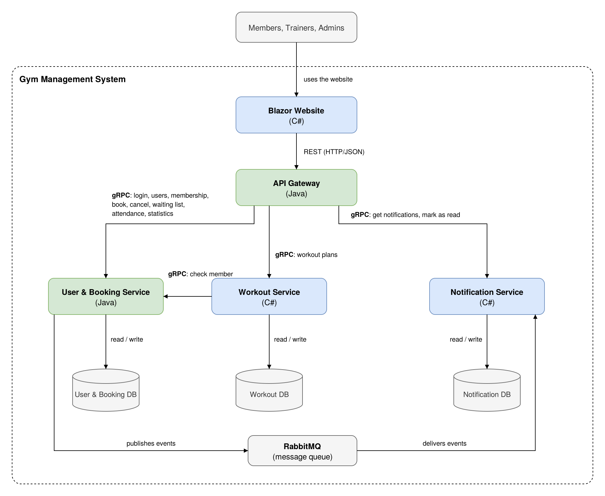

# Gym Management System

A web system for running a fitness centre, where members can book classes, trainers can manage their classes and workout plans, and admins can keep track of the whole gym.

This is our semester project for **SEP3** (Semester Project 3) at **VIA University College**, autumn 2026.

## The problem

Many gyms still handle class bookings, waiting lists and workout plans through a mix of reception desks, paper lists, emails and spreadsheets. This makes it hard for members to know whether there is a free spot, hard for trainers to follow their members' progress, and hard for the gym to see which classes are actually used.

Our goal is to bring all of this into one system that is easy to use for everyone involved.

## Who uses the system

**Members** can see the class schedule, book and cancel classes, join a waiting list when a class is full, see their own workout plan, and get notified in the app when something changes, for example when they are moved from the waiting list into a class.

**Trainers** can see the classes they teach and who is booked, register who attended, and create and update workout plans for their members.

**Admins** can create and manage classes, manage users and their memberships, and see statistics about how the gym's classes are used.

## Main features

- Login with different pages for members, trainers and admins
- Class schedule with booking and cancellation
- Waiting list that automatically moves the next member into a class when a spot opens
- In-app notifications
- Workout plans created by trainers and shared with members
- Attendance registration
- Basic statistics about class popularity and attendance

## Architecture

The system is split into a website and a few independent services, each with its own database.

More details about the architecture and technologies will be added as the project develops.

## Team

- Hasti Torbatzadeh
- Dominik Bagona
- Adam Horelican
- Valentin Medvetchi

## Status

In development
