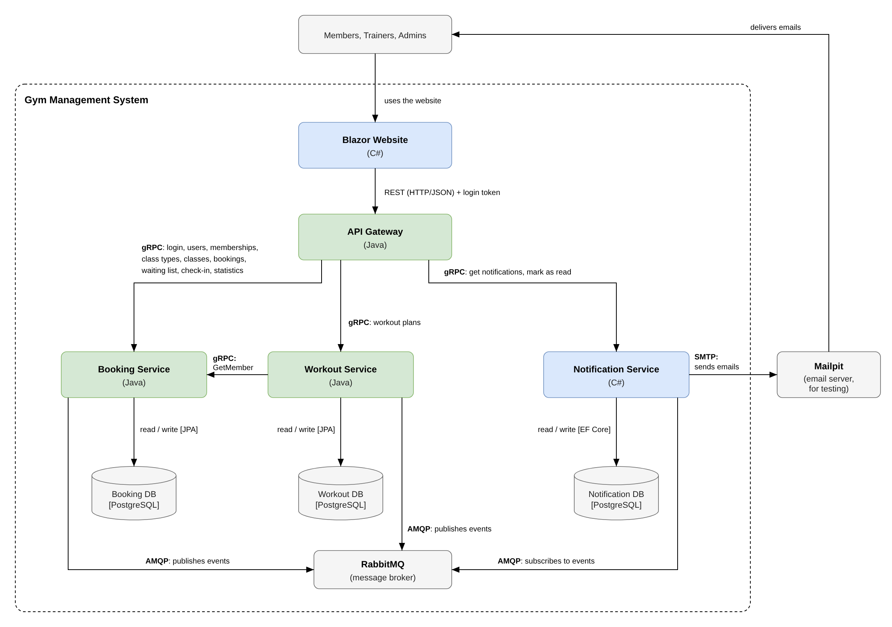

# Gym Management System

This is our semester project for SEP3 at VIA University College, autumn 2026. We are building a system for one gym, where members can book classes and get workout plans, trainers can run their classes, and admins can manage the gym.

## Why

A lot of gyms still do bookings, waiting lists and workout plans with paper lists, emails or Excel. Members don't know if there is a free spot, and the gym doesn't really know which classes people use. We want to put all of this in one system.

## How the gym works

- The gym has one room for classes (yoga, karate, stretching...) and a normal gym area where members can train on their own.
- Every member can go to 2 classes per week (Monday to Sunday). The normal gym area is included in the membership.
- Classes have a limited number of places. When a class is full, you can join the waiting list.
- If somebody cancels, the first person on the waiting list gets an offer and can accept or decline it.
- Trainers make workout plans for members. A member fills in a short form, and the system gives the request to the trainer with the fewest plans.
- Members get notifications in the app and by email.

## Users

- **Member** - books classes, joins waiting lists, checks in at classes, gets workout plans
- **Trainer** - schedules classes, sees who is coming, creates workout plans
- **Admin** - creates accounts and class types, can change any class or plan, sees statistics

## Functional requirements

Sorted by importance, so 1 is the most important.

1. As a user, I want to log in and log out, so that I can securely use the functions of my role.
2. As an admin, I want to create member accounts for people who have paid, so that only paying members can use the system.
3. As an admin, I want to create trainer accounts, so that trainers can schedule classes and create workout plans.
4. As an admin, I want to create, edit and deactivate class types, so that classes can be scheduled under them.
5. As a trainer, I want to schedule a class, so that members can book it.
6. As a member, I want to view the upcoming classes and book one, so that I can take part in it.
7. As a member, I want to view my bookings and cancel one, so that the place becomes available to others.
8. As a member, I want to join the waiting list of a full class, see my position and leave it, so that I can get a place if one becomes free.
9. When a place becomes free, the system shall offer it to the first member on the waiting list.
10. As a member, I want to accept or decline an offered place, so that I only get classes I can actually attend.
11. The system shall notify a member in the app and by email when their booking is confirmed, including the class and time.
12. The system shall notify a member in the app and by email when they are offered a place from the waiting list.
13. The system shall notify all booked members in the app and by email when a class is cancelled.
14. As a trainer, I want to edit or cancel my classes, so that members get correct information.
15. As an admin, I want to schedule, edit or cancel any class, so that I can manage the schedule when needed.
16. As a trainer, I want to view the classes I teach with the booked and waiting members, so that I can prepare.
17. As a member, I want to check in at a class I booked, so that my attendance is recorded.
18. As a member, I want to see my membership end date and how many classes I have left this week, and extend my membership by paying with a button, so that I can keep using the gym.
19. As a member, I want to fill in a workout plan request form, so that a trainer knows my goals and needs.
20. The system shall assign a new plan request to the active trainer with the fewest active plans.
21. As an admin, I want to view, edit and deactivate member and trainer accounts, so that user information stays accurate.
22. As a trainer, I want to view the plan requests assigned to me, so that I can create a suitable plan.
23. As a trainer, I want to create and update workout plans for my members, so that they can train on their own.
24. The system shall notify the member in the app and by email when their workout plan is ready.
25. As a member, I want to view my workout plan and download it as a PDF, so that I can follow it in the gym.
26. As an admin, I want to edit any workout plan, so that I can step in when needed.
27. As an admin, I want to see statistics per class type (attendance rate, how full the classes are on average, average age of participants, and the most popular class types), so that I can plan the schedule.

## Architecture

- **Blazor website (C#)** - what the users see
- **API gateway (Java)** - checks the login and sends requests to the right service
- **Booking service (Java)** - users, memberships, classes, bookings, waiting list, attendance, statistics
- **Workout service (Java)** - workout plans and plan requests
- **Notification service (C#)** - in-app notifications and emails
- **RabbitMQ** - the services send events through it to the notification service
- **PostgreSQL** - every service has its own database

The website talks to the gateway with REST, and the gateway talks to the services with gRPC.

## Team

- Hasti Torbatzadeh
- Dominik Bagona
- Adam Horelican
- Valentin Medvetchi

## Status

In development.